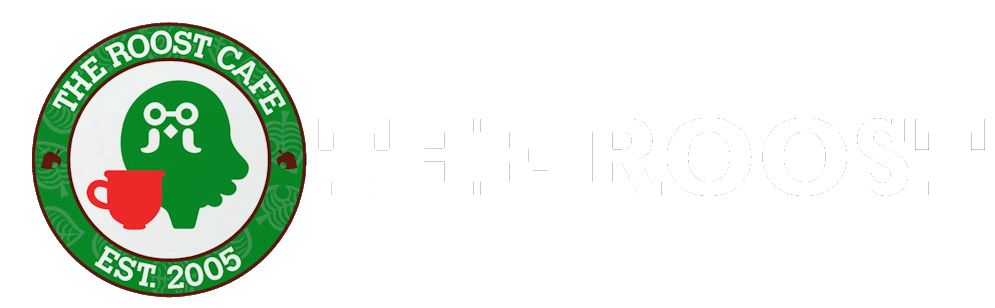

# the roost

a cozy animal crossing-cafe style focus timer for your desktop. work for a bit, chill for a bit, repeat, with music and rain (with thunderstorms too!) going in the background.

## what it does

* **pomodoro timer**: set your own focus and break times. the app remembers your settings so you don't have to redo them every time.
* **smooth song swaps**: songs blend into each other instead of cutting off, so the vibe never breaks.
* **rainy day sounds**: rain and thunder play on their own layer behind the music and fade in and out smoothly.
* **proper shuffle**: the playlist gets shuffled fairly every time you open the app, then loops forever.
* **instant album switching**: the app scans your song folders once when it starts, so changing albums never makes it hang.
* **now playing popups**: a little popup shows the song name, the game it's from, and the album art whenever the song changes.
* **cozy look**: animal crossing cafe theme, custom font, retro buttons, and no accidentally highlighting text everywhere, so it feels like a real desktop app.
* **real desktop app**: made with electron, with its own minimize and close buttons, and it opens fast.

## how to run it

1. install [node.js](https://nodejs.org).
2. grab the code (clone this repo) and run `npm install` inside the folder.
3. add your own music and assets (see below).
4. run `npm start`, or if you're on windows just double click `run.vbs`.

## stuff that's not included

the game music, ambience sounds, sound effects, fonts and album covers aren't in this repo because they belong to their owners. to get sound working, make these folders in the project root and drop in your own files: `OSTs/`, `ambience/`, `fx/`, `album-covers/`, `font/`.

## how to add your own music!

fork this repo and fill the folders above with whatever music, ambience and art you like. right now the default tracklist is:

* Animal Crossing: Nintendo GameCube (2001)
* Animal Crossing: Wild World: Nintendo DS (2005)
* Animal Crossing: City Folk: Nintendo Wii (2008)
* Animal Crossing: New Leaf: Nintendo 3DS (2012)
* Animal Crossing: New Horizons: Nintendo Switch (2020)
* Minecraft: Volume Alpha (2011)
* Minecraft: Volume Beta (2013)
* Super Mario Galaxy (2007)
* The Legend of Zelda: Breath of the Wild (2017)

if you make your own version, i'd love to see it!

1. make a folder inside `OSTs/` and put your audio files in it. the popup shows the file name as the song title (leading track numbers get stripped), so name files like `01 song name.mp3`.
2. open `renderer.js` and add your album to these three lists near the top, using the same key in each:
   * `albumFolders`: the folder path, like `"my-album": "OSTs/My Album"`
   * `gameNames`: the name shown in the popup
   * `albumArtMap`: a cover image from `album-covers/`
3. open `index.html` and add `<option value="my-album">My Album</option>` to the music dropdown. the value has to match your key.
4. run the app and pick your album from the dropdown. the shuffle option automatically includes it.

the popup artist defaults to "Nintendo / Game Sound Team" (and "C418" for minecraft). to change it, edit `parseTrackMetadata` in `renderer.js`.

supported audio formats: mp3, flac, wav and ogg.

if you don't add any audio, the app still opens, it just stays quiet.

want your own name in the greeting? search for `Rishi` in `index.html` and `renderer.js` and swap it for yours.

## status

this is a finished personal project. i'm not planning to add new features as i want to focus on other projects ;-; but if you find a bug, open an issue and i'll take a look. want something new? fork it and make it yours hehe

## ideas i didn't build but wanted to

* streak system
* bells and a shop to customize stuff
* a guided tutorial with isabelle

## what i learned

this was my first real project. i wrote out all the features in a notebook and sketched the ui before building anything, which made the actual building way smoother. i split the plan into a barebones version and an "advanced" version, built the barebones one first, and cut a few ideas that didn't fit the cozy cafe vibe. Google's Gemini helped me translate my ideas into reality and the journey itself taught me a lot of how the logic behind deployed projects work. i had a lot of fun working on this project and i'm a huge animal crossing fan as well :D i aspire to stop relying on generative AI and completely code on my own for my creative freedom. i also learned git and github to push it online for yall :). this is my first independent project and definitely wont be my last :D

## credits

heavily inspired by [stellarsheik](https://www.youtube.com/@stellarsheik)'s youtube videos. the game music from animal crossing, minecraft, super mario galaxy and zelda breath of the wild belongs to its owners.

## disclaimer

the code is under the mit license. the artwork (banner, background, isabelle icon) and any game audio belong to nintendo, C418 and their respective owners. this is a fan project and not affiliated with or endorsed by nintendo nor C418.
